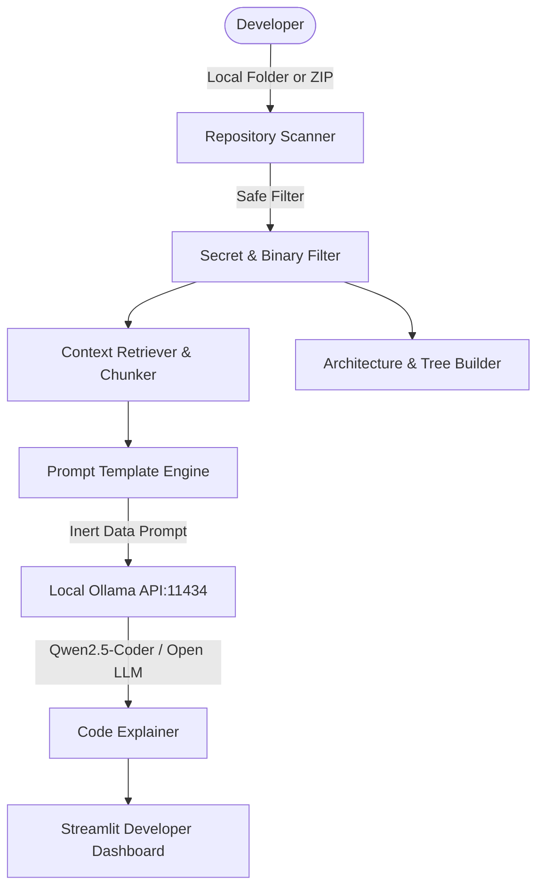

# 🦥 RepoSloth — Local AI Codebase Explainer

> **"Let AI explore the code while you take it slow."**

Built for the **Hacktoberfest 2026 DEV Open-Source AI Challenge, Week 3: “Slow and Steady.”**

RepoSloth is a private, local-first developer tool that helps you instantly understand unfamiliar repositories without opening every single file. Powered by **open-weight models** running locally through **Ollama**, RepoSloth synthesizes architecture, maps entry points, explains complex functions, and answers codebase questions with verifiable line citations.

---

## ✨ Key Features

- 🛡️ **Zero-Execution Sandbox**: Never runs untrusted code, build scripts, or repository hooks.
- 🔒 **100% Local & Air-Gapped**: Runs entirely on your machine via Ollama. No closed API keys, subscription fees, or data leaks.
- 🔐 **Built-in Secret & Traversal Shield**: Redacts API keys, credentials, and `.env` files automatically. Thwarts Zip-Slip path traversal attacks.
- 📋 **Automated Repository Overview**: Distinguishes verified facts (manifests, files, imports) from AI-generated hypotheses.
- 🔍 **File & Function Explainer**: Explains logic flow, parameters, return types, and tricky edge cases.
- 💬 **Ask Your Codebase (Grounded Q&A)**: Ask natural language questions; RepoSloth locates relevant code chunks and cites exact file lines.
- 🗺️ **Visual Architecture & Trees**: Generates clean folder trees and grounded Mermaid architectural diagrams.
- 📝 **Documentation Assistant & Exporter**: Drafts API documentation and exports complete codebase analyses as Markdown.

---

## 🧠 Recommended Open-Weight Models

RepoSloth runs locally using Ollama. Before running, pick a model matching your hardware:

| Model | Ollama Identifier | RAM / VRAM | License | Best Suited For |
| :--- | :--- | :--- | :--- | :--- |
| **Qwen 2.5 Coder (7B)** *(Recommended)* | `qwen2.5-coder:7b` | ~8 GB | Apache 2.0 | State-of-the-art code reasoning, architecture synthesis, deep explanations |
| **Qwen 2.5 Coder (1.5B)** | `qwen2.5-coder:1.5b` | ~3 GB | Apache 2.0 | Ultra-lightweight, runs effortlessly on CPU or low-spec laptops |
| **DeepSeek Coder V2 (16B Lite)** | `deepseek-coder-v2:16b` | ~12 GB | DeepSeek License | Complex multilingual codebases & large architecture diagrams |
| **Code Llama (7B)** | `codellama:7b` | ~8 GB | Llama 2 Community | Meta's code model for Python, C++, and Java codebases |
| **Llama 3.2 (3B)** | `llama3.2:3b` | ~4 GB | Llama 3.2 Community | Fast instruction-following and code summaries |

---

## 🚀 Quickstart Guide

### 1. Prerequisites
- **Python 3.10+**
- **Git**
- **Ollama** installed ([ollama.com](https://ollama.com))

### 2. Install & Start Ollama
Start Ollama and pull your chosen open-weight model:
```bash
# Pull the recommended model (requires initial internet connection)
ollama run qwen2.5-coder:7b
```
*Once downloaded, all AI features work 100% offline.*

### 3. Clone & Install RepoSloth
```bash
git clone https://github.com/song-code-won/RepoSloth.git
cd RepoSloth

# Install Python requirements
pip install -r reposloth/requirements.txt
```

### 4. Launch Application
```bash
streamlit run reposloth/app.py
```
Open your browser to `http://localhost:8501`.

---

## 🧪 Automated Testing

RepoSloth includes a comprehensive automated test suite covering security, file scanning, and context retrieval without needing an active model:

```bash
python -m pytest reposloth/tests
```

### Test Coverage Highlights:
- ✅ **Zip-Slip Prevention**: Verifies malicious paths (`../../etc/passwd`) are blocked.
- ✅ **Secret Redaction**: Checks that tokens (`AKIA...`, `ghp_...`, Bearer tokens) are masked.
- ✅ **Directory & Binary Ignore**: Ensures `node_modules`, `.git`, `.venv`, and images are skipped.
- ✅ **Context Retrieval**: Validates snippet matching and line-range preservation.
- ✅ **Offline Ollama Fault Handling**: Tests graceful recovery when the local daemon is down.

---

## 🔒 Security & Privacy Model

When dealing with third-party code, safety is paramount:
1. **Inert Data Processing**: Source code is ingested strictly as data literals, neutralizing prompt injection attempts.
2. **Never Execute**: Code is parsed using static line analyzers, never executed with `python` or `node`.
3. **Redaction Pipeline**: Files named `.env`, `id_rsa`, or containing known credential patterns are stripped before entering the context window.
4. **Air-Gapped Friendly**: No telemetry, analytics, or external API pings.

---

## 🗺️ Mermaid Architecture Diagram



---

## 📄 License

RepoSloth is licensed under the [MIT License](LICENSE).
Open-weight models accessed via Ollama are governed by their respective licenses (e.g., Apache 2.0 for Qwen 2.5 Coder).
