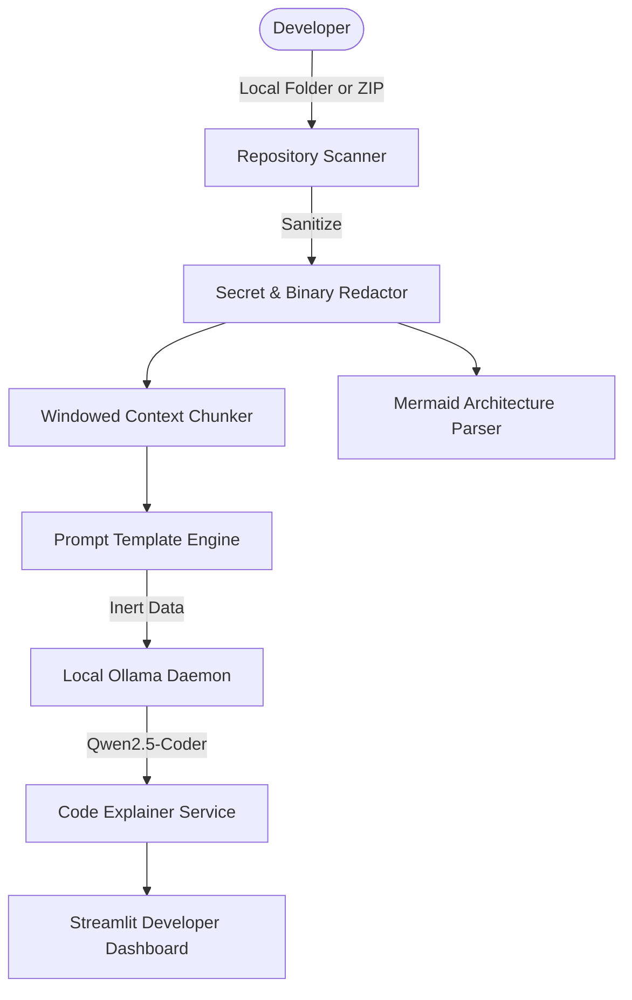

*This article is submitted for the Hacktoberfest 2026 DEV Open-Source AI Challenge, Week 3: “Slow and Steady.”*

---

## 🦥 The Problem: The Cognitive Fatigue of Unfamiliar Codebases

Every developer knows the sinking feeling of landing on an open-source project with dozens of directories, no clear entry point, sparse documentation, and files hundreds of lines long. 

You find yourself doing the **Codebase Shuffle**:
1. Opening random files in `src/` to guess what they do.
2. Searching for `main` or `run` across 1,000 files.
3. Guessing how authentication works or where database connections are pooled.
4. Spending hours of mental energy before writing a single line of code.

For Week 3 of Hacktoberfest's DEV Challenge — **“Slow and Steady”** — I wanted to tackle this exact pain point. Instead of rushing and feeling overwhelmed, what if an AI could patiently do the reconnaissance work for you, while you take it slow?

Enter **RepoSloth** — a private, local-first AI codebase explainer powered entirely by open-weight models.

---

## 🚀 What is RepoSloth?

> **Tagline:** *Let AI explore the code while you take it slow.*

RepoSloth is an open-source developer dashboard built with **Python, Streamlit, and Ollama**. You point it to any local Git repository or drop in a ZIP archive, and it instantly builds a complete mental model of the codebase for you:

1. **AI Codebase Synthesis**: Explains the core purpose, detected frameworks, entrypoints, and setup instructions.
2. **File & Function Explainer**: Breaks down complex files, function parameters, logic flow, and hidden edge cases.
3. **Ask Your Codebase (Grounded Q&A)**: Ask questions like *"Where does authentication happen?"* or *"Where should I add a new endpoint?"* and receive answers with verifiable file and line-number citations.
4. **Mermaid Architecture Explorer**: Auto-generates visual module diagrams and directory trees.
5. **Documentation Assistant & Exporter**: Drafts API docs and exports comprehensive reports to Markdown.

---

## 🛡️ Security First: Never Trust Untrusted Code

When building an AI tool that inspects arbitrary source code, security cannot be an afterthought:
- **Zero Execution Sandbox**: RepoSloth never runs or compiles repository code.
- **Zip-Slip Traversal Prevention**: File extractions are validated to prevent malicious archives from writing outside the sandbox.
- **Automated Secret Filtering**: Credentials, high-entropy tokens, AWS keys, and `.env` files are automatically stripped and redacted before touching AI prompts.
- **Prompt Injection Defense**: Code is injected into system prompts as inert data literals with strict boundary delimiters.

---

## 🧠 Why Open-Weight AI (Ollama + Qwen 2.5 Coder)?

RepoSloth does **not** use closed proprietary APIs (no OpenAI, Anthropic, or credit cards required). It is designed to run 100% locally using **Ollama**.

We default to **Qwen 2.5 Coder (7B)** (Apache 2.0 license), which delivers exceptional code comprehension and architectural reasoning. For developers with lower hardware specs, **Qwen 2.5 Coder (1.5B)** runs smoothly on CPU with less than 4 GB of RAM!

### Key Benefits of Open-Weight Local Inference:
- **Complete Privacy**: Proprietary company code never leaves your workstation.
- **Offline Capable**: Once your model is pulled, you can analyze code on an airplane or in air-gapped secure networks.
- **No API Rate Limits or Token Costs**: Analyze codebases with thousands of lines freely.

---

## 🏗️ Architecture & Technology Stack

- **Frontend**: Streamlit
- **Analysis Engine**: Python standard library (`pathlib`, `ast`, `os`)
- **Retrieval**: Windowed code chunker with TF-IDF keyword & token scoring
- **Inference**: Ollama REST API (`http://localhost:11434`)
- **Automated Tests**: Pytest (14 passing tests with mocked LLM fallbacks)

---

## 🎥 Walkthrough & Demo Script

Here is how simple it is to explore an unfamiliar repo:
1. Start Ollama: `ollama run qwen2.5-coder:7b`
2. Launch RepoSloth: `streamlit run reposloth/app.py`
3. Point to `./sample_repo` (a FastAPI microservice included in the repo).
4. RepoSloth immediately detects `app.py` as the entrypoint, flags FastAPI and Pydantic from `requirements.txt`, and generates an overview.
5. In the **Ask Your Codebase** tab, ask: *"How does authentication work?"*
6. RepoSloth retrieves lines 1-17 of `auth.py`, cites the line numbers, and explains token verification!

---

## 💻 Links & Contribution

- **GitHub Repository**: [https://github.com/song-code-won/RepoSloth](https://github.com/song-code-won/RepoSloth)
- **License**: MIT License

*Take it slow, write clean code, and let RepoSloth do the heavy lifting!*
