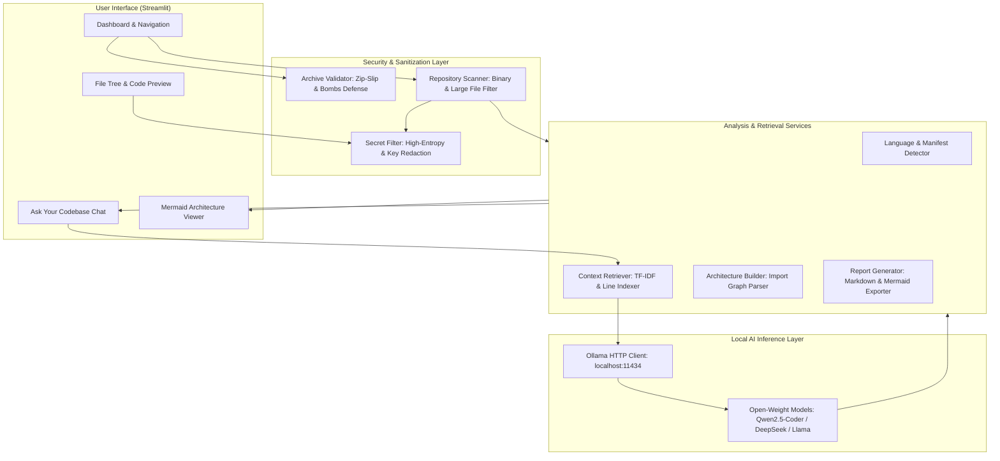

# RepoSloth Architecture & Security Guide

## 1. Overview
RepoSloth is a 100% local, read-only AI codebase explanation tool. It parses repositories, extracts structural features, filters potential secrets and binary data, and queries locally hosted open-weight models (via Ollama) to assist software engineers in onboarding and understanding unfamiliar codebases.

## 2. Component Diagram

## 3. Data Flow
1. **Import:** User provides a local directory or uploads a ZIP file.
2. **Safety Validation:**
   - Archives are checked for traversal attempts (`../`) and decompression limits.
   - Credentials (`.env`, `*.pem`, `id_rsa`) are isolated.
   - Text contents are scanned for high-entropy tokens and redacted.
3. **Indexing:**
   - Manifests (`package.json`, `requirements.txt`, etc.) are parsed.
   - Code is sliced into windowed chunks with preserved line numbers.
4. **Local Prompting:**
   - Prompts enforce inert data rules: model is instructed to treat code as passive data, mitigating prompt injection.
   - Queries are routed to Ollama over localhost.

## 4. Threat Model & Safeguards
- **Arbitrary Code Execution:** RepoSloth strictly inspects files with standard I/O. It never invokes `exec()`, `eval()`, package managers (`pip install`, `npm install`), or shell hooks.
- **Data Exfiltration:** Operates entirely offline. No telemetry, third-party analytics, or external API endpoints.
- **Zip-Slip:** Sanitizes extracted paths using `Path.relative_to(dest_dir)` before file creation.
